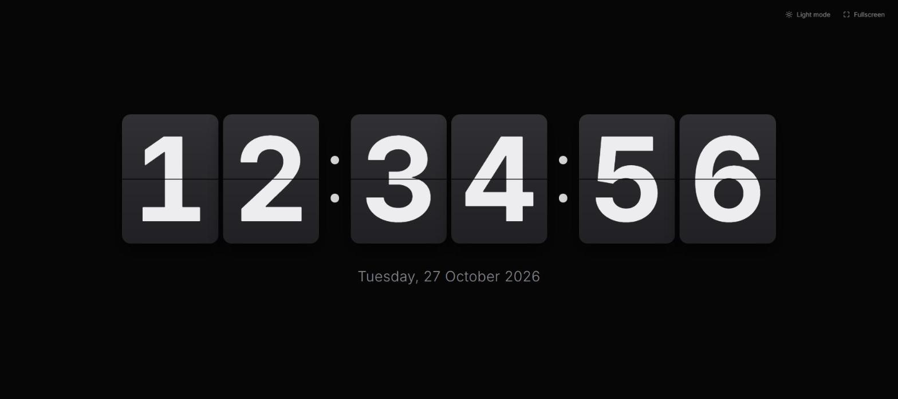

# Flip Clock

A minimal flip clock for the browser. It shows the current time as animated split-flap digits, with the date underneath. It is plain HTML, CSS and JavaScript, with no build step and no dependencies.



## Features

- Flip animation on each digit as the time changes
- Light and dark themes. It follows your device setting until you pick one, and then remembers your choice
- Fullscreen mode. The controls and cursor hide after 10 seconds without mouse movement
- Respects `prefers-reduced-motion`
- Coming soon: Pomodoro timer functionality

## Getting started

Clone the repo and serve the folder with any static file server. For example:

```sh
git clone <repo-url>
cd timer
npx serve .
# or: python -m http.server 5500
```

Then open the URL it prints, for example `http://localhost:5500`.

You can also open `index.html` directly in a browser.

## Project structure

| File         | Purpose                                              |
| ------------ | ---------------------------------------------------- |
| `index.html` | Page markup                                          |
| `styles.css` | Layout, themes and flip animation                    |
| `script.js`  | Clock ticking, theme toggle, fullscreen and idle UI  |
| `docs/`      | README assets                                        |

## Notes

The page loads the [Inter](https://fonts.google.com/specimen/Inter) font from Google Fonts. Without a connection, it falls back to a system font.
